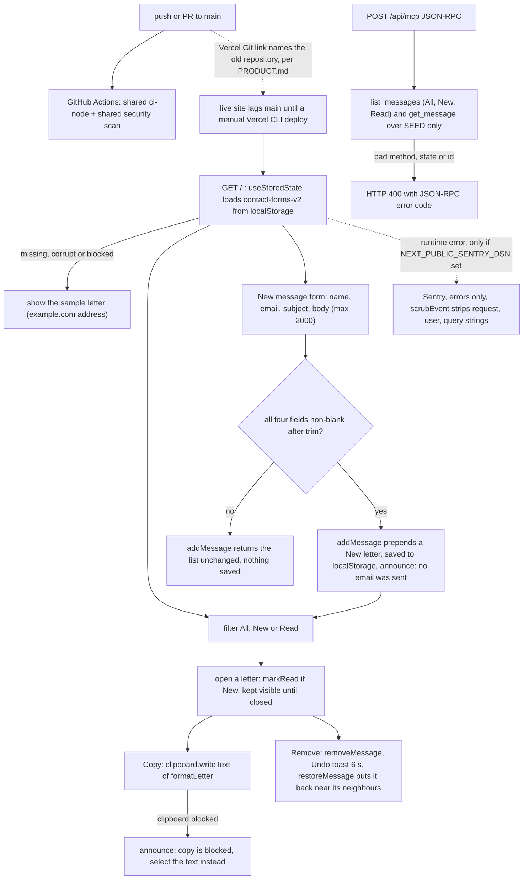
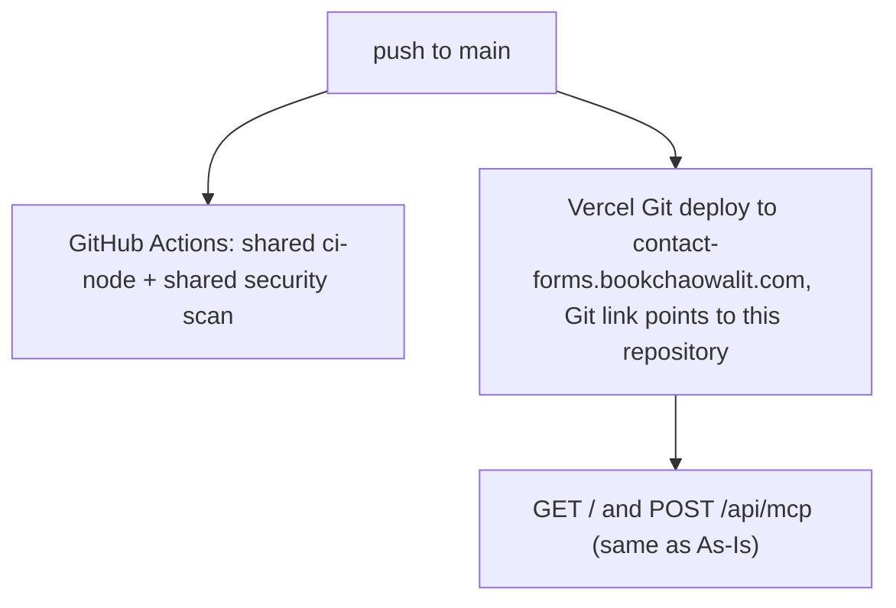

# 01 — Business process (As-Is / To-Be)

marketing-contact-forms-web คือต้นแบบฟอร์มติดต่อและกล่องจดหมายในหน้าเดียว (contact-forms.bookchaowalit.com) เขียน แล้วอ่านใน browser เดียวกัน เก็บใน localStorage ไม่ส่งอีเมลและไม่มีฐานข้อมูล พร้อม `/api/mcp` แบบ stateless ที่เห็นเฉพาะจดหมายตัวอย่าง

Last reviewed: 2026-11-28 · commit `5a8869a`

## As-Is (จากโค้ดวันนี้)

Sources: `app/page.tsx`, `lib/contact-forms.ts`, `lib/use-stored-state.ts`, `app/api/mcp/route.ts`, `lib/sentry.ts`, `next.config.ts`, `PRODUCT.md`

ข้อเท็จจริงจากโค้ด: ไม่มี outbound email, CRM sync หรือการตรวจผู้ส่ง; `/api/mcp` ไม่มี auth/rate limit ในโค้ด (เปิดสาธารณะ ส่งกลับเฉพาะจดหมายตัวอย่าง). ไม่มี `app/robots.ts` และ `app/sitemap.ts` ใน repo นี้ (ต่างจากแอปพี่น้อง) [ต้องยืนยัน] ว่าตั้งใจหรือไม่. PRODUCT.md อ้าง Vercel Analytics แต่ไม่พบในโค้ด [ต้องยืนยัน]. [ต้องยืนยัน] สถานะ deploy ปัจจุบัน (PRODUCT.md บันทึกเมื่อ 2026-10-23).

## To-Be (PRODUCT.md §Live URL and deploy state)

Sources: `PRODUCT.md` (owner action D9: reconnect Vercel Git to this repository)

## Gap

| ID | As-Is → To-Be | Status | Owner | Evidence |
|---|---|---|---|---|
| G1 | Vercel Git link ชี้ repo เก่า, deploy ด้วย CLI → เชื่อมกับ repo นี้ให้ push to `main` deploy เอง | decide | owner | `PRODUCT.md` §Live URL and deploy state (owner action D9) |
| G2 | PRODUCT.md อ้าง Vercel Analytics แต่ไม่พบในโค้ด → ตรวจแล้วแก้เอกสารหรือยืนยันที่ Vercel | todo | claude | `package.json`, `app/layout.tsx` (ไม่มี import) |

## Open questions

- repo นี้ไม่มี `app/robots.ts` / `app/sitemap.ts` ตั้งใจหรือไม่
- production มี Sentry และ MCP route ปัจจุบันหรือยัง
